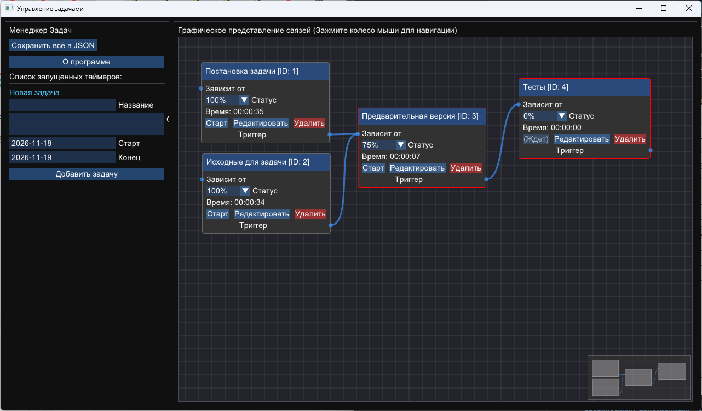
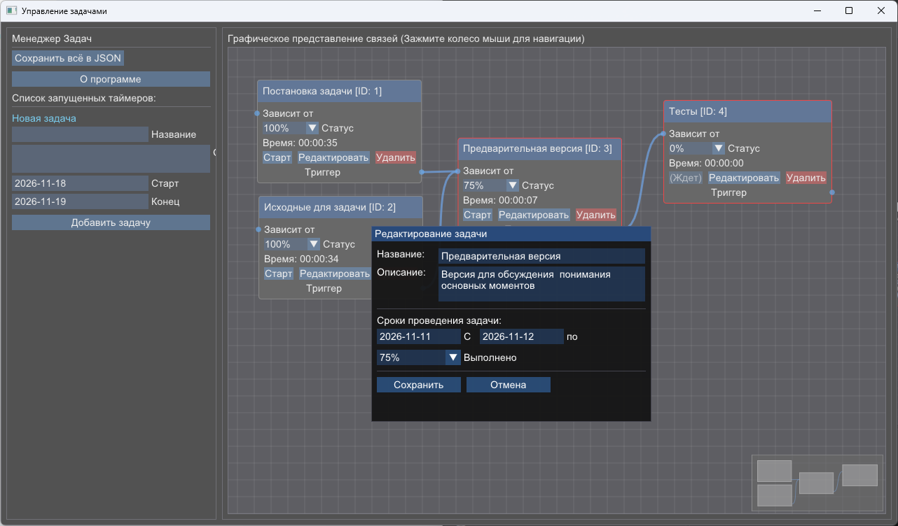

# Node-Based Task Manager (Графический менеджер задач)

Десктопное приложение для управления задачами и проектами с визуальным представлением зависимостей в виде направленного графа (нод). Программа избавляет от сложных таблиц и позволяет наглядно видеть, какие задачи блокируют дальнейшую работу.

## Основные функции

* **Нодовый интерфейс:** размещение задач на интерактивной сетке, свободное перемещение по холсту (зажатием колеса мыши) и быстрая навигация с помощью мини-карты в правом нижнем углу.
* **Гибкие зависимости:** связывание задач между собой («Триггер» -> «Зависит от»). Дочерняя задача автоматически переходит в режим ожидания (`Ждет`), пока не будут завершены родительские узлы.
* **Трекинг прогресса:** быстрое изменение статуса выполнения задачи по шагам (`0%`, `25%`, `50%`, `75%`, `100%`) с цветовой индикацией состояния карточки.
* **Планирование и тайм-трекинг:** задание периода исполнения (дата старта и конца), а также встроенный секундомер для фиксации реального времени работы над каждой задачей.
* **CRUD-операции и JSON:** полноценное редактирование, удаление задач и сохранение всего графа связей в структурированный JSON-файл.

### P.S.: Программа cоздана из любопытства для своих нужд, занимаюсь графическими приложениями, сайтами. Прилагается ознакомительная версия, проект развивается, приветствуются пожелания, если понравится, пишите, за небольшую денежку пришлю полноценный вариант.